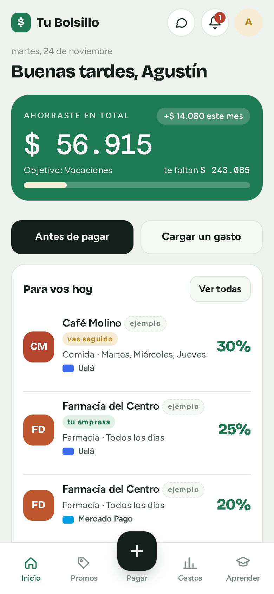

# Tu Bolsillo

App web (PWA) que le dice a cada persona con qué medio de pago le conviene pagar en cada comercio, registra cuánto ahorró y enseña finanzas personales. Incluye un bot que recolecta promociones reales de bancos y billeteras virtuales, y paneles para comercios, empresas y administración.

<p align="center"></p>

## Funcionalidades

- **"Antes de pagar"**: según el comercio, el día y los medios de pago de la persona, muestra la mejor promoción disponible y sus topes.
- **Bot de promociones**: recorre fuentes oficiales (MODO, Brubank, Personal Pay, Cuenta DNI, Ualá, Macro, American Express, Banco Ciudad), extrae las promos, las verifica y las deja para revisión. Respeta el `robots.txt` de cada sitio y usa un navegador headless (Playwright) para las páginas que se arman con JavaScript.
- **Aprendizaje por confirmaciones**: cada "me funcionó / no me funcionó" ajusta la confianza de la promo y de su fuente; las promos con quejas vuelven solas a revisión.
- **Roles**: persona, comercio, empresa y administración, cada uno con su panel. Las empresas solo ven datos agregados, nunca de una persona.
- **Gastos y ahorro**: carga de gastos, gastos fijos automáticos, objetivo de ahorro y alertas de tope.
- **Notificaciones push**, recuperación de contraseña por mail, métricas de uso y retención, términos y privacidad.
- **Descarga y borrado de datos** por parte de cada usuario.

## Stack

| Capa | Tecnología |
|---|---|
| Backend | Python 3, Flask, Waitress |
| Base de datos | SQLite |
| Scraping | requests, BeautifulSoup, Playwright |
| Frontend | JavaScript, HTML, CSS, PWA |
| Integraciones | Web Push, SMTP, API de Claude (opcional, para promos en texto libre o imagen) |
| Calidad | pytest (62 tests) |
| Deploy | Docker, Railway |

## Arquitectura

```
run.py                arranque y comandos (bot, crear-admin, sin demo)
tubolsillo/
  server.py           API REST y paneles por rol
  core.py             mejor medio de pago, topes, ahorro, personalización
  db.py               esquema SQLite
  catalog.py          medios de pago, rubros, contenidos
  scheduler.py        bot periódico, avisos y alertas
  push.py / mail.py   notificaciones y mails
  metrics.py          métricas de uso y retención
  recurring.py        gastos fijos
  bot/
    fuentes.py        fuentes de promociones configuradas
    fetch.py          descarga respetando robots.txt (requests o Playwright)
    extract.py        extracción de promos (reglas o modelo de lenguaje)
    verify.py         verificación, publicación y aprendizaje
  static/             frontend PWA
tests/                tests de API, núcleo, bot y fuentes
```

## Cómo correrlo

```bash
pip install -r requirements.txt
python run.py
```

Abrir `http://127.0.0.1:8770` y entrar con una cuenta de ejemplo (*Persona*, *Comercio*, *Empresa* o *Administración*; contraseña `demo1234`).

Otros comandos:

```bash
python run.py bot                     # correr el bot de promociones una vez
python run.py --sin-demo              # arrancar sin datos de ejemplo
python run.py crear-admin tu@mail.com # crear un administrador
```

## Tests

```bash
python -m pytest
```

Cubren la API y la autenticación, el cálculo del mejor medio de pago y los topes, la extracción y verificación de promociones (con páginas de ejemplo) y la configuración de las fuentes.

## Deploy y operación

Publicación en Railway, variables de entorno, instalación en el celular y funcionamiento del bot: [docs/OPERACION.md](docs/OPERACION.md).
